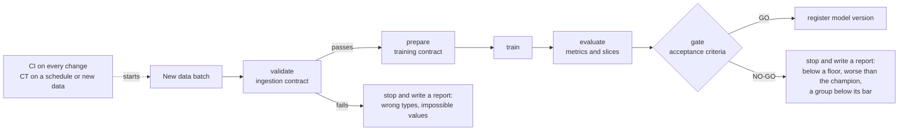

# Written test: preparation guide

**Lifecycle of Artificial Intelligence Systems**

This guide tells you what the written test (ZH) asks, what to revise for each week, and what a good
answer looks like.

---

## 1. The test

- **When and where:** Wednesday 2 December 2026, 12:15, room IL108 (the Week 13 lab slot).
- **Format:** on paper, closed book, 60 minutes.
- **Scope:** the lectures and study notes of **Weeks 1–12**. Week 13 (governance) and Week 14 (summary
  and LLMOps) are not examined.
- **Weight:** the test is 40% of your grade. You need at least 50% of its points to pass the subject.
  You can retake it once, in the retake week.
- **Shape:** about ten questions.
  - About 6 **short questions**: explain a concept, or the difference between two concepts.
  - 3 **scenario questions**: a situation is described. You decide what to do and justify it, or you
    say why something failed and which practice would have caught it.
  - 1 **drawing task**: for example, the lifecycle with the place of each practice and the failure it
    stops.
- **What is not asked:** the labs are not examined directly. You do not need commands, file syntax or
  API names from memory. A tool name helps only when you can say what problem the tool solves.

The test checks whether you can explain the machine learning lifecycle in your own words.

---

## 2. How to prepare

1. Read the study notes in [`docs/notes/`](notes/), and the decks in [`lectures/`](../lectures/) for
   the cases and diagrams. Practise drawing the diagrams from memory.
2. Answer the "Check yourself" questions at the end of each notes file without looking.
3. Use §4 as a checklist: can you explain every concept listed for each week?
4. Write full answers to the example questions in §5, and compare them with the worked answers in §6.

---

## 3. How answers are marked

Every week of the course followed the same frame, and the questions follow it too:

1. **The situation:** where in the lifecycle the team is, and what it is trying to do.
2. **The problem:** what goes wrong without the practice.
3. **The practice:** what solves the problem, and how.
4. **The cost and the limit:** what the practice takes to run, and what it still does not catch.

A full-marks answer has these parts:

- **Short question:** a definition in your own words, the difference between the two concepts, and one
  example or consequence. "They check different things" earns nothing. Three to five sentences.
- **Scenario question:** your decision in the first sentence. Then the practice you use and why it fits
  this situation, what it costs, and what it still does not catch. More than one decision can earn full
  marks if the justification is sound. About half a page.
- **Drawing task:** the parts in the right order, each part labelled, and the failure each check stops.
  Boxes and arrows are enough.

A suggested time plan: about 4 minutes for each short question, 8 for each scenario, 10 for the drawing.

---

## 4. Week by week

Each week gives its frame, then the concepts you must be able to explain. You do not have to recite
numbers, but a number from a case makes an answer stronger.

### Week 1 · Introduction to MLOps

- **Situation:** a model works on one laptop, and the team wants to run it as a product.
- **Problem:** an ML system can fail with no error. Zillow Offers (2021): the pricing model overpaid for
  homes as the market shifted, and about $300M was written off in one quarter. Every request returned HTTP 200.
- **Practice:** MLOps manages code, data and the model together. Its three pillars are reproducibility,
  scalability and automation.
- **Cost and limit:** automation does not remove engineering judgement, and bad automation scales
  mistakes faster. Some problems should not use ML at all.

Explain: deterministic vs probabilistic systems · the triad of change (code, data, model state) ·
research vs production · why an ML system fails without an error · the production myths · when not to
use ML · the roles around the loop · the lifecycle loop and its stages (Design and Build, Test, Deploy,
Operate and Monitor).

### Week 2 · Reproducible runtimes

- **Situation:** the Week 1 pipeline runs on one laptop and records nothing that lasts.
- **Problem:** a different seed moves the accuracy by about 5 percentage points with the same code and
  data. Nobody can say which run produced the number in the report.
- **Practice:** a reproducible run with pinned dependencies and images. Each run is recorded in shared
  stores: code in Git, metadata in a relational database, artifacts in an object store. An MLflow
  tracking server sits in front, and Docker Compose starts the stack with one command.
- **Cost and limit:** four services to run and pin. Comparing runs and choosing a model is Week 3.

Explain: developer run vs reproducible run · the four inputs of a result (code, data, config and seeds,
environment) · metadata vs artifacts, and why each has its own store · why the client needs only the
tracking server's address · pinned images, named volumes, and a service that is "started" vs "ready".

### Week 3 · Experiment tracking

- **Situation:** the team trains many runs and must choose one model to use.
- **Problem:** the Epic Sepsis Model. The vendor's documentation reported an AUC of 0.76–0.83. An
  external study (Wong et al., 2021) measured 0.63, and the model missed 1,709 of the 2,552 sepsis
  cases. Hospitals could not say which version ran, what data trained it or who approved it.
- **Practice:** track every run (parameters, metrics, tags, artifacts) and compare runs with a query.
  Register the chosen model with versions and aliases, promote it with its evidence, and trace it back.
- **Cost and limit:** logging code and discipline. The chain ends at a file path, so the data is unknown
  (Week 4). Whether the model is good enough is Week 6.

Explain: experiment vs run · the job of parameters, metrics, tags and artifacts (reproduce, compare,
find, deploy) · run vs registered model version · version vs alias · champion and challenger · promotion
as a process, where moving the alias is the last step · traceability from an alias back to the code.

### Week 4 · Data versioning

- **Situation:** the run records the path of the data file, not its content.
- **Problem:** COVID-19 imaging models (Roberts et al., 2021). Of 2,212 studies found, 62 were reviewed in
  full and 0 were of potential clinical use. In "Frankenstein datasets", the same images could be in
  the training data and the test data.
- **Practice:** content-addressed versioning (DVC): a pointer file with the hash goes in Git, the data
  goes to an object store. The pipeline is declared in one file and recorded in a lock file. The data
  hash is tagged on the MLflow run.
- **Cost and limit:** a remote, keys, a second `push` and a cache. Too much for a small file that never
  changes. A hash records bad data faithfully: a glucose of 0 gets a version too (Week 5).

Explain: content-addressed storage · why Git is not made for data · workspace, cache and remote, and
which way push, pull and checkout move data · the declared pipeline vs the record of what ran · "is this
newer?" (`make`) vs "is this different?" (`dvc repro`) · the chain from an alias to the code and the data.

### Week 5 · Data quality

- **Situation:** the data has a version, but nobody has checked its quality.
- **Problem:** our dataset has 652 impossible zeros, 374 of them in `insulin`. Unity (2022): bad data from
  a large customer reached its ad model and cost about $110 million of revenue, by Unity's estimate.
- **Practice:** a data contract, written down and implemented in code (Pandera), run as a gate stage that
  stops the pipeline and writes a report. Two contracts at two boundaries, and the same contract at
  serving time.
- **Cost and limit:** every rule needs an owner and an action, or its alerts get ignored. A contract
  passes wrong labels and plausible wrong values (a BMI of 28.0 typed as 26.0).

Explain: data contract · the types of data error (schema, values, completeness, uniqueness,
distribution) · sentinel values · ingestion contract vs training contract, and why a zero is legal at one
and illegal at the other · gate vs warning · imputing inside the pipeline, and data leakage ·
training-serving skew and its most common cause · why drift checks stay out of the contract.

### Week 6 · Model quality gates

- **Situation:** the data is checked. May the trained model leave the development loop?
- **Problem:** Gender Shades (2018). IBM's face classifier was 87.9% correct overall, but wrong on 34.7%
  of darker-skinned women and 0.3% of lighter-skinned men. In our own pipeline, a model with `C: 0.001`
  never predicts diabetes: F1 0.0000, while its ROC-AUC (0.8407) is higher than ours (0.8345).
- **Practice:** acceptance criteria, written before the run and versioned: floors, regression against
  the champion, slices, fairness. A go/no-go gate stops the pipeline on NO-GO and writes a report.
- **Cost and limit:** measure the noise before you set a tolerance. Small groups get skipped. If the
  label measures the wrong thing (Obermeyer et al., 2019: cost instead of health), every check passes.

Explain: threshold metrics (accuracy, precision, recall, F1) vs ROC-AUC · baselines · floor vs
regression check · the ratchet ("the bar moves up") · slices and their two support rules (rows and
positive cases) · skipped vs passed vs failed · demographic parity, equal opportunity and equalized odds,
and why one model cannot satisfy all three · allocation harm vs quality-of-service harm.

### Week 7 · CI/CT

- **Situation:** the data contract and the model gate exist, but they run only when someone types the
  pipeline command.
- **Problem:** CrowdStrike (19 July 2024). A content update with new detection rules crashed 8.5 million
  Windows computers. The code path was tested, the content path was not. In ML, a new data batch or a
  scheduled retraining is also a path into production.
- **Practice:** continuous integration (CI) checks every change automatically on a fresh machine, with
  one pipeline definition for laptop and CI. Continuous training (CT) retrains when a person, a schedule
  or new data starts it, and the data contract and the model gate stand in for the code reviewer.
- **Cost and limit:** build time on every push, and pins to update. A green build can hide a missing
  check, a threshold set too low, a skipped test or a workflow that never ran.

Explain: continuous integration vs an integration test · the runner · the test layers (unit, data, eval,
integration) and which run in CI · pinning someone else's code (branch, tag, commit SHA) · one pipeline
definition vs two copies · CI vs CT · every path into production needs checks · a release tag (names the
code) vs a registry version (names the model) · the four identifiers of a model.

### Week 8 · Orchestration

- **Situation:** retraining runs on a schedule. Nobody knows whether each run happened and how it ended.
- **Problem:** a scheduled run can be delayed, dropped, or disabled after 60 days without activity. Toy
  Story 2 (Pixar): about 90% of the film was deleted by mistake. The backups had failed at a 4 GB file
  limit, and the error log was on the same full disk, so nobody was warned.
- **Practice:** an orchestrator (Prefect) runs a graph of steps on a schedule and records every run.
  Retries with backoff and jitter, only where a second try can succeed and is safe, and time limits.
- **Cost and limit:** a server and a database to run. For one script on one schedule, a cron job and a
  check on the last success are enough. A record has no row for a run that never happened (Week 11).

Explain: `dvc repro` ("is this stale?") vs an orchestrator ("did it run, and how did it end?") · run
states, and Failed vs Crashed · what happens to later tasks when one fails · which errors a retry can fix
(503, 429) and which it cannot (403, a failed validation) · fixed delay vs exponential backoff vs jitter
· idempotent tasks · settings in a commit vs flow parameters · why every task needs a time limit.

### Week 9 · Model serving

- **Situation:** a GO model is in the registry, but nobody can use it yet.
- **Problem:** a model file cannot answer anyone. A generic model server scores a patient with a glucose
  of 0 without complaint. One container crashes and nobody restarts it. Latency costs money:
  Booking.com measured that about 30% more latency cost about 0.5% of conversion rate.
- **Practice:** an API that checks each request with the training contract (422 when a check fails). The
  model is baked into a container image, and the build checks the gate verdict. Kubernetes runs two
  copies behind one address and replaces a copy that fails.
- **Cost and limit:** a 1.04 GB image, and machines running all day. A new image reaches every user at
  once, and nothing checks whether the new model is better (Week 10).

Explain: deployment vs model serving · what must travel with the model · batch vs online inference ·
latency vs throughput · why we report p50 and p95, not the mean · checking types vs checking values with
the contract · the decision threshold, stored with the model version · image vs container · bake the
model in vs fetch it at startup · a gate check in every path that can ship a model · Pod, Deployment and
Service, and the controller · readiness probe vs liveness probe.

### Week 10 · Rollout strategies

- **Situation:** a new model version must replace the old one on real traffic.
- **Problem:** a bad model is deployed and everything is green: pods running, `/health` 200, every request
  200. Yet it flags 0 of 192 test patients. GPT-4o (April 2025): an update went to all users, and it took
  about 4 days to start the rollback. No check measured the problem.
- **Practice:** separate deploy from release, and choose canary, blue/green or shadow. Smoke-test the new
  version at 0% traffic. Write a rollout plan with the rules to promote and to roll back. Roll back by
  changing the declaration, and test the rollback.
- **Cost and limit:** a canary needs a few extra pods, blue/green 2× while both run, shadow 2× all the
  time. 10% of traffic is 10% of real patients. Nobody watches at 3 a.m. (Week 11).

Explain: deploy vs release · canary vs blue/green vs shadow, and how to choose · canary vs A/B test ·
probe vs smoke test vs load test · what a smoke test checks (identity, contract, behaviour, protocol) ·
concurrency vs throughput, and why a latency needs its error rate · offline vs online evaluation · what
the ML engineer hands to the platform team · rollback for each strategy.

### Week 11 · Observability

- **Situation:** the model is served. Every check so far runs once, when someone starts it.
- **Problem:** nobody sees a failure between the checks. Too many alarms are as bad: people stop
  responding to them (alarm fatigue in hospitals).
- **Practice:** collect metrics from the running service, set service level objectives, and alert a
  person only when users feel the problem now and someone can act now.
- **Cost and limit:** fewer pages means a later alert. Every panel can be green while the model is wrong.

Explain: metrics vs logs vs traces · SLI, SLO and SLA, and the error budget · page, ticket or nothing ·
alert fatigue, and how to avoid it.

### Week 12 · Drift and degradation

- **Situation:** the service is healthy. Are the inputs still like the training data?
- **Problem:** the inputs move while every dashboard is green (Google Flu Trends).
- **Practice:** compare recent inputs with a pinned reference, watch proxy metrics, and agree a reaction
  protocol before the signal arrives.
- **Cost and limit:** logging the inputs stores personal data. Concept drift is invisible without labels.

Explain: data drift vs concept drift, and which you can see without labels · drift vs degradation ·
reference window vs current window · proxy metrics · the reaction protocol (do nothing on purpose, roll
back, collect labels, retrain) · why a retraining trigger needs labels and must keep the gate.

---

## 5. Example questions

These show the kind of question to expect. The test uses other questions.

### Short questions

1. (Week 1) Why can an ML system fail while every request returns HTTP 200? What would classic DevOps
   monitoring show, and what would it miss?
2. (Week 2) Distinguish metadata and artifacts. Where does each go, and why not in one store?
3. (Week 4) Why is a file path or a date not enough to say which data trained a model?
4. (Week 5) What is training-serving skew? Why does it produce no error?
5. (Week 6) Distinguish a floor from a regression check. Give one failure that each catches and the
   other misses.
6. (Week 7) Distinguish CI from CT. What starts each, and what replaces the code reviewer in CT?
7. (Week 8) Distinguish a Failed run from a Crashed run. For each, would a retry help?
8. (Week 10) Distinguish deploy and release. Who decides each?
9. (Week 11) A request was slow. When do you look at a metric, a log line or a trace?
10. (Week 12) Distinguish data drift from concept drift. Which can you detect without labels, and why?

### Scenario questions

11. (Week 4) Your project uses a 2 MB public dataset. Its provider publishes numbered versions and never
    changes a published version. A colleague wants to set up DVC with a remote. Decide and justify.
12. (Week 5) A new clinic sends glucose in mmol/L instead of mg/dL. The batch passes the data contract,
    and the model now predicts "no diabetes" for almost everyone. Why did the contract pass the batch,
    and which practice would have caught it?
13. (Week 6) Your model decides who gets a loan. The product owner asks for a gate on all three fairness
    metrics. Decide what you gate, and justify it.
14. (Week 7) New data arrives every Monday as a commit that changes only a `.dvc` file. A scheduled job
    retrains the model every night. CI runs only the linter and the unit tests. Last month a bad batch
    reached a registered model. Why, and which practice would have stopped it?
15. (Week 8) A flow task sends each patient a reminder SMS through an external service. The call
    sometimes times out. A colleague sets `retries=5` on the task. Do you accept the change?
16. (Week 10) Your new model decides which card payments to block. Choose a rollout strategy and write
    the rollback rule. Justify both.
17. (Weeks 11–12) The SLO is met and every panel is green, but the share of positive predictions has
    doubled in two weeks. The true labels arrive months later. What do you do?

### Drawing tasks

18. (Weeks 1–12) Draw the lifecycle loop. Place on it the practices of Weeks 2–12, and for each practice
    write the failure it stops.
19. (Weeks 3–4) A model answers requests in production. Draw the chain you follow to find the code and
    the data that trained it. Label each link with the record that makes the step possible.
20. (Weeks 5–7) Draw the training pipeline from a new data batch to a registered model. Show where the
    checks run, what each check stops, and what happens when one fails.

---

## 6. Worked answers

### Short question: deploy vs release (question 8)

To deploy means that the new version runs on the servers. To release means that users get the new
version's answers. The platform team decides the deployment. For a model, the ML engineer decides the
release. Because the two are separate, a new model can run at 0% traffic first: we smoke-test it on its
own address, and no user sees an answer from it. Then a canary releases it to 10% of requests, and we
can roll back by setting that share to 0.

*Why it gets full marks:* both definitions, who decides each, and a consequence (testing at 0%, a
gradual release). Five sentences.

### Scenario question: retries on the SMS task (question 15)

**Decision:** not as it is. I accept a retry only after the task is safe to run twice, with fewer
attempts and a delay between them.

**Practice and why it fits:** a timeout may pass on a second try, so a retry can help. But the task is
not idempotent. If the service sent the SMS and only the answer was lost, a retry sends it again. First
I make the task idempotent: each attempt sends the same idempotency key, and the service ignores a key
it has already seen. Then I set two or three retries with exponential backoff and jitter, so the retries
of many tasks do not hit the service at the same moment.

**Cost:** extra code for the key, and later results because of the delays. Five retries would also hide
a service that is down: the run looks fine, only slow.

**What it still does not catch:** a retry cannot fix an error that will not pass, such as a rejected
request (403). The run must end as Failed and alert its owner. A run that never starts leaves no failed
run to see at all.

*Why it gets full marks:* a decision first, the practice tied to this task (a timeout can pass, an SMS
must not be sent twice), the cost and the limit. About half a page.

### Drawing task: the training pipeline and its checks (question 20)

The drawing must show:

- the stages in order: new batch, validate, prepare, train, evaluate, gate, register
- the data contract at the ingestion boundary and at the model's input, and what each stops
- the model gate after evaluation, and that only a GO model is registered
- what happens on a failure: the stage exits with an error, nothing after it runs, and a report is
  written
- who starts the pipeline: CI on every change, and CT on a schedule or on new data

*Why it gets full marks:* the order is right, each check names the failure it stops, the failure path
is drawn, and the triggers from Week 7 are shown. A few labelled boxes are enough. The layout does not
need to match this one.
