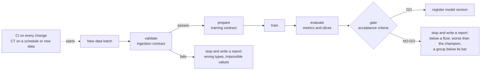

# Written test: preparation guide

**Lifecycle of Artificial Intelligence Systems**

This guide tells you what the written test (ZH) asks, what to revise for each week, and what a good
answer looks like.

---

## 1. The test

- **When and where:** Wednesday 2 December 2026, 12:15, room IL108 (the Week 13 lab slot).
- **Format:** on paper, closed book, 60 minutes.
- **Scope:** the lectures and study notes of **Weeks 1–12**. Week 13 (governance) and Week 14 (summary
  and LLMOps) are not examined.
- **Weight:** the test is 40% of your grade. You need at least 50% of its points to pass the subject.
  You can retake it once, in the retake week.
- **Shape:** about ten questions.
  - About 6 **short questions**: explain a concept, or the difference between two concepts.
  - 3 **scenario questions**: a situation is described. You decide what to do and justify it, or you
    say why something failed and which practice would have caught it.
  - 1 **drawing task**: for example, the lifecycle with the place of each practice and the failure it
    stops.
- **What is not asked:** the labs are not examined directly. You do not need commands, file syntax or
  API names from memory. A tool name helps only when you can say what problem the tool solves.

The test checks whether you can explain the machine learning lifecycle in your own words.

---

## 2. How to prepare

1. Read the study notes in [`docs/notes/`](notes/), and the decks in [`lectures/`](../lectures/) for
   the cases and diagrams. Practise drawing the diagrams from memory.
2. Answer the "Check yourself" questions at the end of each notes file without looking.
3. Use §4 as a checklist: can you explain every concept listed for each week?
4. Write full answers to the example questions in §5, and compare them with the worked answers in §6.

---

## 3. How answers are marked

A full-marks answer has these parts:

- **Short question:** a definition in your own words, the difference between the two concepts, and one
  example or consequence. Three to five sentences.
- **Scenario question:** your decision in the first sentence. Then the practice you use and why it fits
  this situation, what it costs, and what it still does not catch. More than one decision can earn full
  marks if the justification is sound. Six to ten sentences.
- **Drawing task:** the parts in the right order, each part labelled, and the failure each check stops.
  Boxes and arrows are enough.

A suggested time plan: about 4 minutes for each short question, 8 for each scenario, 10 for the drawing.

---

## 4. Week by week

For each week, the concepts you must be able to explain.

### Week 1 · Introduction to MLOps

- Deterministic vs probabilistic systems
- DevOps vs MLOps
- The triad of change (code, data, model state)
- Research vs production
- Latency vs throughput
- Why an ML system fails without an error
- When not to use ML
- Roles in the lifecycle

### Week 2 · Reproducible runtimes

- Developer run vs reproducible run
- The four inputs of a result (code, data, config and seeds, environment)
- Metadata vs artifacts, and why each has its own store

### Week 3 · Experiment tracking

- Experiment vs run
- The job of parameters, metrics, tags and artifacts (reproduce, compare, find, deploy)
- Run vs registered model version
- Version vs alias
- Champion and challenger
- Promotion as a process
- Traceability from an alias back to the code

### Week 4 · Data versioning

- Content-addressed storage
- Why Git is not made for data
- Workspace, cache and remote, and which way push, pull and checkout move data
- The declared pipeline vs the record of what ran
- The chain from an alias to the code and the data

### Week 5 · Data quality

- Data contract
- The types of data error (schema, values, completeness, uniqueness, distribution)
- Sentinel values
- Ingestion contract vs training contract
- Gate vs warning
- Imputing inside the pipeline, and data leakage
- Training-serving skew and its most common cause
- Why drift checks stay out of the contract

### Week 6 · Model quality gates

- Threshold metrics (accuracy, precision, recall, F1) vs ROC-AUC
- Baselines
- Floor vs regression check
- Slices and their two support rules (rows and positive cases)
- Demographic parity, equal opportunity and equalized odds, and why one model cannot satisfy all three
- Allocation harm vs quality-of-service harm

### Week 7 · CI/CT

- Continuous integration vs an integration test
- The test layers (unit, data, eval, integration)
- CI vs CT
- Every path into production needs checks
- A release tag (names the code) vs a registry version (names the model)
- The four identifiers of a model

### Week 8 · Orchestration

- `dvc repro` ("is this stale?") vs an orchestrator ("did it run, and how did it end?")
- Run states, and Failed vs Crashed
- What happens to later tasks when one fails
- Which errors a retry can fix (503, 429) and which it cannot (403, a failed validation)
- Fixed delay vs exponential backoff vs jitter
- Idempotent tasks
- Why every task needs a time limit

### Week 9 · Model serving

- Deployment vs model serving
- What must travel with the model
- Batch vs online inference
- Latency vs throughput
- Why we report p50 and p95, not the mean
- Checking types vs checking values with the contract
- Image vs container
- Pod, Deployment and Service, and the controller

### Week 10 · Rollout strategies

- Deploy vs release
- Canary vs blue/green vs shadow, and how to choose
- Probe vs smoke test vs load test
- What a smoke test checks (identity, contract, behaviour, protocol)
- Concurrency vs throughput, and why a latency needs its error rate
- Offline vs online evaluation
- What the ML engineer hands to the platform team

### Week 11 · Observability

- Point-in-time checks vs monitoring
- The four golden signals (traffic, errors, latency, saturation)
- Metrics vs logs vs traces
- Monitoring vs observability
- Why percentiles do not average across replicas
- SLI, SLO and SLA, and the error budget
- Why a 422 does not count against the availability SLI
- What each extra "nine" costs
- Burn rate, and why the alert uses a long and a short window

### Week 12 · Drift and degradation

- The test-set assumption (new data comes from the same distribution)
- Data drift, label shift, concept drift and schema drift
- Label delay, and fast weak labels
- Why precision and F1 change with the share of positives while recall and ROC-AUC do not
- Reference window vs current window
- What a prediction log stores, and what to decide before you switch it on
- Fixed vs sliding windows, and window size
- What K-S, PSI, Wasserstein and chi-squared measure, and why a p-value alarms more as traffic grows
- Setting a threshold without past incidents
- Drift vs degradation, and what to do in each of the four cases

---

## 5. Example questions

These show the kind of question to expect.

### Short questions

1. (Week 1) Why can an ML system fail while every request returns HTTP 200? What would classic
   monitoring show, and what would it miss? Give an example.
2. (Week 2) Distinguish metadata from artifacts. Give an example of each, say where each goes, and
   explain why they are not stored together.
3. (Week 4) Why is a file path or a date not enough to say which data trained a model? Give an
   example where the path stays the same but the data changes.
4. (Week 5) What is training-serving skew? What is its most common cause, and why does it produce no
   error?
5. (Week 7) Distinguish CI from CT. What starts each, and what replaces the code reviewer in CT?
6. (Week 10) Distinguish deploy and release. Who decides each, and why is it useful to separate them?
7. (Week 11) A request was slow. When do you look at: a metric, a log line or a trace?
8. (Week 12) Distinguish data drift, label shift and concept drift. Which ones can you detect without
   labels, and why?

### Scenario questions

9. (Week 4) Your project uses a 2 MB public dataset. Its provider publishes numbered versions and never
   changes a published version. A colleague wants to set up a data-versioning tool (like DVC) with a
   remote. Decide and justify.
10. (Week 6) Your model decides who gets a loan. The product owner asks for a gate on all three fairness
    metrics. Decide what you gate, and justify it.
11. (Week 7) New data arrives every Monday as a commit that changes only a pointer file (such as a
    `.dvc` file). A scheduled job retrains the model every night. CI runs only the linter and the unit
    tests. Last month a bad batch reached a registered model. Why, and which practice would have
    stopped it?
12. (Week 10) Your new model decides which card payments to block. Choose a rollout strategy and write
    the rollback rule. Justify both.
13. (Weeks 11–12) The SLO is met and every panel is green, but the share of positive predictions has
    doubled in two weeks. The true labels arrive months later. What do you do?

### Drawing tasks

14. (Weeks 1–12) Draw the lifecycle loop. Place on it the practices of Weeks 2–12, and for each practice
    write the failure it stops.
15. (Weeks 3–4) A model answers requests in production. Draw the chain you follow to find the code and
    the data that trained it. Label each link with the record that makes the step possible.
16. (Weeks 5–7) Draw the training pipeline from a new data batch to a registered model. Show where the
    checks run, what each check stops, and what happens when one fails.

---

## 6. Example answers

**Question 6 (Week 10).** Distinguish deploy and release. Who decides each, and why is it useful to
separate them?

Deploying means putting the new model version on the servers so it is running and reachable. Releasing
means routing real user traffic to it so users receive its predictions. The platform team owns the
deployment, while the ML engineer decides when and how to release a model. Keeping the two separate
lets you deploy a new version at 0% traffic first, run smoke tests against its own address, and
only then release it to a small share of requests (for example, a 10% canary). If something looks
wrong, you can roll back immediately by setting the traffic share back to 0% without tearing down the
deployment.

**Question 9 (Week 4).** Your project uses a 2 MB public dataset. Its provider publishes numbered
versions and never changes a published version. A colleague wants to set up a data-versioning tool
(like DVC) with a remote. Decide and justify.

**Decision:** no data-versioning tool with a remote for now. I keep the file in Git, record the
provider's version number, and record the file's hash with every run.

**Practice and why it fits:** we version data so that we can say exactly which data trained a model.
Here the provider already does most of this work: a published version never changes, so the version
number names the content. The file is 2 MB, so Git can store it without problems. The hash, recorded
with each run, proves that the file is really the one the version number names. The training script
checks the hash and stops if it does not match.

**Cost:** almost nothing: one hash per run and a check in the script. A data-versioning tool with a
remote would cost a storage service, access keys, a second push and a local cache, and it would solve
no problem we have.

**What it still does not catch:** a hash records bad data faithfully: if the provider's data has
errors, every version of them gets the same trust. That needs data quality checks. The
decision also changes when the situation changes: if we start to clean, join or add our own data, the
data starts to change between runs, and then a data-versioning tool with a remote becomes worth its
cost.

**Question 16 (Weeks 5–7).** Draw the training pipeline from a new data batch to a registered model.
Show where the checks run, what each check stops, and what happens when one fails.

The drawing must show:

- the stages in order: new batch, validate, prepare, train, evaluate, gate, register
- the data contract at the ingestion boundary and at the model's input, and what each stops
- the model gate after evaluation, and that only a GO model is registered
- what happens on a failure: the stage exits with an error, nothing after it runs, and a report is
  written
- who starts the pipeline: CI on every change, and CT on a schedule or on new data

